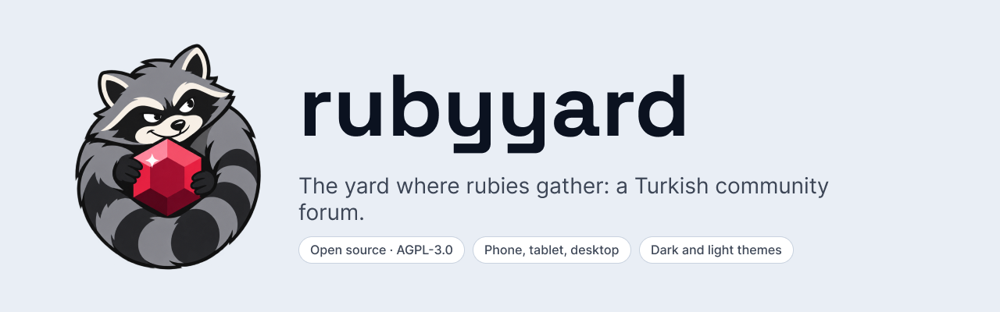
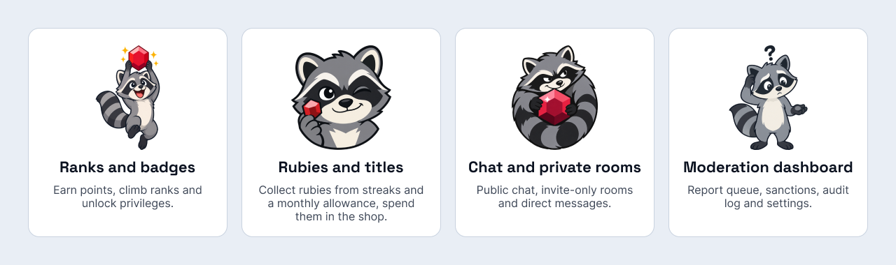
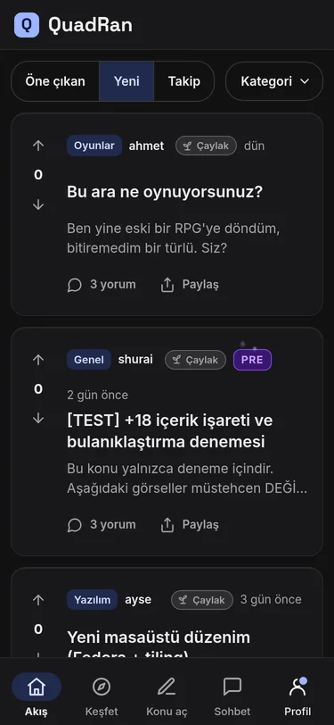
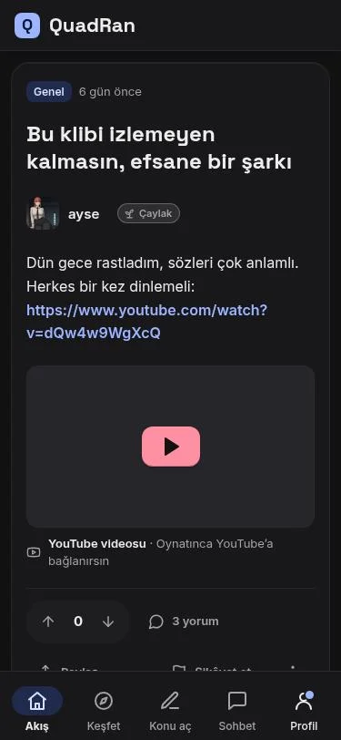
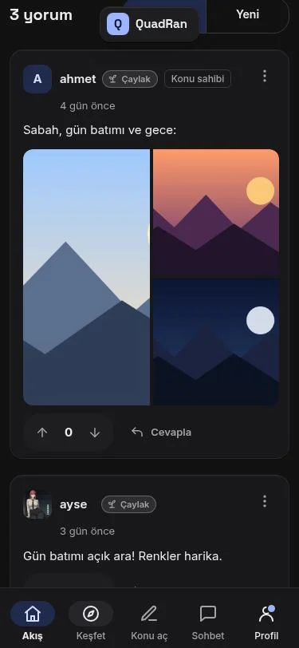
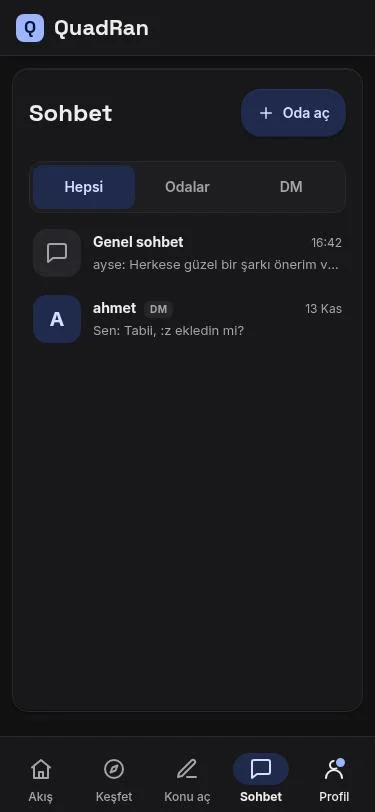
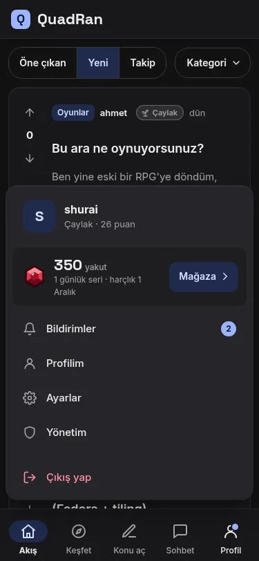
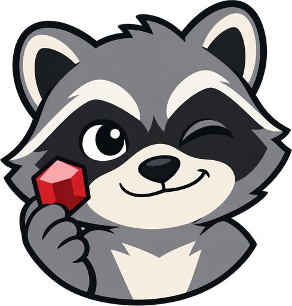
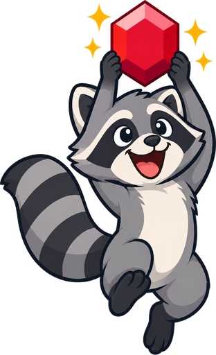
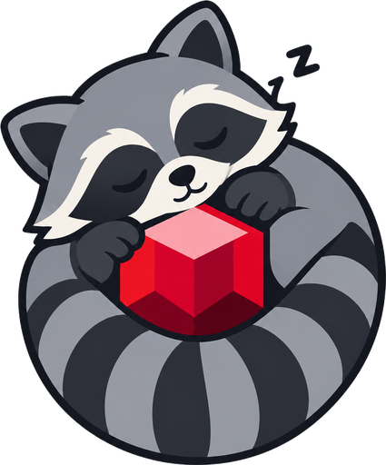

<picture>
  <source media="(prefers-color-scheme: dark)" srcset="docs/marka/github/en/header-dark.png">
  
</picture>

<p align="center"><b>English</b> · <a href="README.tr.md">Türkçe</a></p>

<p align="center">
  <b>Version 0.7.0</b> ·
  Node.js 22 · Express 5 · EJS · MySQL 8.4 · Docker Compose ·
  <a href="LICENSE">AGPL-3.0</a>
</p>

rubyyard is a Turkish-language community forum. Members open topics in categories, reply and vote; as they earn points they
climb ranks, collect **rubies** (the site's currency) and unlock titles. There is a public chat, invite-only private rooms,
direct messages, notifications and a full moderation dashboard.

The site's interface is in Turkish today; English UI support is planned. Code comments are written in both English and Turkish.

<picture>
  <source media="(prefers-color-scheme: dark)" srcset="docs/marka/github/en/features-dark.png">
  
</picture>

## Screens

Phone, tablet and desktop each have their own layout. These are phone screens with sample content from `npm run ornek`.

| Feed | YouTube card | Photo attachments | Chat | Profile: rubies and notifications |
|---|---|---|---|---|
|  |  |  |  |  |

## Features

**Forum**
- Feed: Featured / New / Following, category filter, pinned topics on top
- Topics: replies, up/down votes, editing and deleting your own posts, locked topics
- Attachments: photos, video (custom player), YouTube and GitHub cards, an 18+ flag; outgoing links ask "you're leaving the site" first
- Profiles: avatar and banner, profile effects and avatar decorations, rank progress, badges, follow / followers
- Ranks unlock privileges (e.g. opening a private room) and celebrate when you level up
- **Rubies**: daily login streaks, a monthly allowance by rank, a shop and titles
- Public chat and private rooms (by invite or expiring link), direct messages with read receipts, blocking, notifications
- Search, leaderboards (week / month / all time), reports (post, user, chat message, direct message)
- Appearance: dark / light / system theme, 5 accent colours, compact cards, "reduce motion"
- Status pages (404, 403, 429, 500, maintenance) and an offline page (service worker)

**Accounts and security**
- scrypt password hashing, sessions stored in MySQL, "remember me"
- CSRF token on every POST form, a strict CSP (no inline scripts), rate limits on login / sign-up / password reset
- Changing your password signs out your other devices
- EXIF data is stripped from uploaded photos; video file signatures are checked

**Moderation dashboard (`/yonetim`)**
- Overview: what needs attention, metrics, 30-day charts
- Moderation: one report queue (context, author history, a reason is required for every decision), sanctions (timed or permanent bans), a banned-words filter
- Forum, chat, members (member card), points and rewards (point rules, ranks, badges, rubies, titles)
- Announcements and broadcast notifications, open/close sign-ups, maintenance mode, an audit log (who did what, when)
- Roles: admins can do everything; moderators use Overview, Moderation, Forum, Chat and Members

## Getting started



Requirements: Docker (with Compose) and Node.js 22.18+

```sh
git clone https://github.com/Shuraimr/rubyyard.git
cd rubyyard
cp .env.example .env          # fill in the passwords and SESSION_SECRET
docker compose up -d          # on first start MySQL runs the files in sql/ in order
npm install
npm run dev                   # http://localhost:3000
```

Generate a long random `SESSION_SECRET`:

```sh
node -e "console.log(require('crypto').randomBytes(32).toString('hex'))"
```

- Site: http://localhost:3000 · Dashboard: http://localhost:3000/yonetim
- Adminer (database UI): http://localhost:8080
- `npm start`: production mode (design preview pages under `/onizleme` are disabled)
- `npm run ornek`: adds sample topics, replies, photo and video attachments (`npm run ornek -- --sil` removes only those)

**Test users** (seed data, password `test1234`): `shurai` (admin), `ayse` (moderator), `ahmet` (member).
Change these passwords before you expose the site to anyone else.

### With Nix (optional)

`flake.nix` defines a project-specific dev shell: Node 22, the MySQL client, ffmpeg, gh, jq. It does not touch your system tools; the database still runs in Docker.

```sh
nix develop                   # fish users: nix develop -c fish
nix develop -c npm run dev    # one command without entering the shell
```

All in one: `./araclar/konsol.sh` starts the database and opens the server (`npm run dev`), the [mycli](https://www.mycli.net)
database client, the MySQL log and a shell side by side in [zellij](https://zellij.dev); a second "Denetim" tab has the type check and
Docker status (layout: `araclar/zellij/rubyyard.kdl`). If the session already exists it attaches to it.

With [direnv](https://direnv.net) installed, run `direnv allow` once and the shell opens whenever you enter the folder (`.envrc`).

### Updating an existing database

Docker runs the `sql/` files only when the database is first created. Apply newer files to an existing database by hand, in order:

```sh
for f in sql/22_*.sql sql/23_*.sql sql/24_*.sql; do
  docker exec -i rubyyard-db sh -c 'mysql -uroot -p"$MYSQL_ROOT_PASSWORD" rubyyard' < "$f"
done
```

(Run only the files you haven't applied yet; applying one twice fails with "column already exists".)

## Project layout

```
src/
  server.ts           middleware and routers are wired here
  db.ts               mysql2 connection pool
  oturum.ts           sessions, CSRF, data every page needs
  yardimci.ts         rank/points SQL helpers, notifications, auth middleware
  rutbe.ts, yakut.ts  rank privileges; ruby balance and rewards
  ekler.ts            post attachments (photos, video, cards)
  rotalar/            routes: account, forum, posts, follow, messaging, rooms, rubies, moderation, dashboard
views/                EJS templates (partials/ shared pieces, yonetim/ dashboard)
public/css, public/js plain CSS and a single dependency-free script
sql/                  schema, seed data and ordered migrations (01 → 24)
docs/AKTARIM.md       detailed developer notes (Turkish): routes, tables, permission matrix, known gaps
docs/marka/           brand guide: logo, raccoon mascot, colours (separately licensed)
```

File and identifier names are Turkish (for example `yakut` = ruby, `rutbe` = rank, `rotalar` = routes, `yonetim` = dashboard).

## Database

| Table | Purpose |
|---|---|
| `users`, `roles`, `ranks` | Users, roles (admin, moderator, member), point-based ranks |
| `categories`, `topics`, `posts`, `post_votes` | Forum: categories, topics, posts and votes |
| `badges`, `user_badges` | Badges and who earned which (N:N) |
| `points_log`, `yakut_log` | Ledgers of point and ruby movements |
| `chat_messages`, `messages` | Public chat and direct messages |
| `notifications` | Notifications |
| `reports` | Reports, by target type (post, user, chat message, direct message, room message) |
| `audit_log`, `site_settings` | Staff action log and settings changed from the dashboard |
| `password_resets`, `sessions` | Password reset tokens and sessions |

- Ranks are not stored; they are computed from points. Users, topics and posts are soft-deleted (`deleted_at`).
- Every user-supplied value reaches SQL through `?` placeholders. No ORM: plain SQL.

## Design



The interface was designed in Figma first: information architecture, a design system (colour variables, components, motion rules)
and screens. Phone (≤800px), tablet (801–1180px) and desktop (>1180px) were each designed separately; dark, light and system themes
and "reduce motion" work on every screen. Brand guide: [`docs/marka`](docs/marka). Sketches of the first version (v0.1) are archived
in [`docs/tasarim`](docs/tasarim).

## Status and roadmap

The forum, ranks, private rooms, profile customisation, following, rubies and the shop, and post attachments all work. Known gaps
(no real e-mail delivery yet, chat is not live) are listed in [`docs/AKTARIM.md`](docs/AKTARIM.md). Next up: offers of help on
questions, super comments and tips, referral-based rooms, English UI, and multiplayer games.

## License



**Code:** [GNU Affero General Public License v3.0](LICENSE) or later. You may use, modify and even run it as a paid service, but
when you make a modified version available to others (including as a website), you must publish its source under the same license.
The binding text is the [LICENSE](LICENSE) file.

**Brand:** the name "rubyyard", the raccoon mascot, the logo and the images in [`docs/marka`](docs/marka) and
[`public/img/marka`](public/img/marka) are **not** covered by the AGPL; all rights reserved. Using them requires written permission;
if you fork the code, remove the name and the mascot. Details: [docs/marka/LICENSE.md](docs/marka/LICENSE.md).
