# QuadRan

Türkçe bir forum sitesi. Üyeler kategorilere ayrılmış konular açar, cevap yazar, oy verir; puan topladıkça rütbe ve rozet kazanır. Genel sohbet, davetle girilen özel odalar, özel mesajlar, bildirimler ve moderatörler için gelişmiş bir yönetim paneli vardır.

**Sürüm:** 0.6.0 · **Teknolojiler:** Node.js 22 (TypeScript'i doğrudan çalıştırır) · Express 5 · EJS · MySQL 8.4 (ORM yok, saf SQL) · Docker Compose

## Özellikler

**Site**
- Akış: kategori süzgeci, Yeni / Popüler / En iyi sıralaması, sabitlenmiş konular en üstte
- Konu sayfası: cevap, oy (+1 / −1), kendi mesajını düzenleme ve silme, kilitli konular
- Profil: konular ve yorumlar sekmeleri, rütbe ilerlemesi, rozetler, haftalık katkı grafiği
- Genel sohbet ve özel odalar (davetle ya da davet bağlantısıyla girilen grup sohbetleri; oda açmak rütbe ister), özel mesajlar ("görüldü" bilgisiyle), engelleme, bildirimler
- Arama (konu, kullanıcı, kategori), sıralama (hafta / ay / tüm zamanlar)
- Şikâyet: konu mesajı, kullanıcı, sohbet mesajı ve özel mesaj şikâyet edilebilir
- Görünüm ayarları: koyu / açık / sistem teması, 5 vurgu rengi, kompakt kartlar, animasyonları azaltma
- Masaüstü, tablet ve telefon için ayrı düzenler; özel açılır menüler ve hafif animasyonlar

**Hesap ve güvenlik**
- scrypt ile şifre hash'leme, MySQL'de saklanan oturumlar, "beni hatırla"
- Her POST formunda CSRF belirteci, giriş / kayıt / şifre sıfırlamada hız sınırı
- Şifre değişince diğer cihazlardaki oturumlar kapanır
- Şifre sıfırlama (geliştirmede bağlantı sunucu konsoluna yazılır; SMTP henüz yok)

**Yönetim paneli (`/yonetim`)**
- Bakış: ilgilenilmesi gerekenler (bekleyen şikâyetler, süresi dolan uzaklaştırmalar, yeni hesaplar), metrikler, 30 günlük grafikler
- Moderasyon: tek şikâyet kuyruğu (bağlam, yazar geçmişi, sebebi zorunlu karar), yaptırımlar, yasaklı kelime filtresi
- Forum, Sohbet, Üyeler (üye kartı), Puan ve ödüller (puan kuralları, rütbeler, rozetler)
- Duyurular ve toplu bildirim, kayıtları açma/kapama, işlem kaydı (kim, ne zaman, ne yaptı)
- Yetki: admin her şeye erişir; moderatör Bakış, Moderasyon, Forum, Sohbet ve Üyeler'i kullanır (rol, puan kuralları ve site ayarları yalnızca admin'de)

## Kurulum

Gereksinimler: Docker (Compose ile) ve Node.js 22.18+

```sh
git clone https://github.com/Shuraimr/QuadRan.git
cd QuadRan
cp .env.example .env          # şifreleri ve SESSION_SECRET'ı doldur
docker compose up -d          # MySQL ilk açılışta sql/ klasöründeki dosyaları sırayla çalıştırır
npm install
npm run dev                   # http://localhost:3000
```

`SESSION_SECRET` için uzun, rastgele bir değer üret:

```sh
node -e "console.log(require('crypto').randomBytes(32).toString('hex'))"
```

- Site: http://localhost:3000 · Yönetim paneli: http://localhost:3000/yonetim
- Adminer (veritabanı arayüzü): http://localhost:8080
- `npm start`: yayın modu (tasarım önizleme sayfaları `/onizleme` kapalı)

**Test kullanıcıları** (seed verisi, şifreleri `test1234`): `shurai` (admin), `ayse` (moderatör), `ahmet` (üye)

### Var olan bir veritabanını güncellemek

Docker `sql/` dosyalarını yalnızca veritabanı ilk oluşturulurken çalıştırır. Önceden kurulmuş bir veritabanına yeni dosyaları sırayla elle uygula:

```sh
for f in sql/06_*.sql sql/07_*.sql sql/08_*.sql sql/09_*.sql sql/10_*.sql; do
  docker exec -i quadran-db sh -c 'mysql -uroot -p"$MYSQL_ROOT_PASSWORD" quadran' < "$f"
done
```

(Yalnızca henüz uygulanmamış dosyaları çalıştır; aynı dosyayı iki kez uygulamak "sütun zaten var" hatası verir.)

## Proje yapısı

```
src/
  server.ts           ara katmanlar ve route'ların bağlandığı yer
  db.ts               mysql2 bağlantı havuzu
  oturum.ts           oturum, CSRF, her sayfada gereken ortak veriler
  yardimci.ts         rütbe/puan SQL parçaları, bildirim, giriş zorunlu ara katmanı
  rotalar/            hesap, forum, mesaj, iletisim, moderasyon, yonetim-*
views/                EJS şablonları (partials/ ortak parçalar, yonetim/ panel)
public/css, public/js düz CSS ve bağımlılıksız tek bir betik
sql/                  şema, seed ve sırayla uygulanan değişiklikler (01 → 10)
docs/AKTARIM.md       ayrıntılı geliştirici notları: route'lar, tablolar, yetki matrisi, bilinen eksikler
```

## Veritabanı

| Tablo | Açıklama |
|---|---|
| `users`, `roles`, `ranks` | Kullanıcılar, roller (admin, moderatör, üye), puana göre rütbeler |
| `categories`, `topics`, `posts`, `post_votes` | Forum: kategoriler, konular, mesajlar ve oylar |
| `badges`, `user_badges` | Rozetler ve kimin hangisini kazandığı (N:N) |
| `chat_messages`, `messages` | Genel sohbet ve özel mesajlar |
| `notifications` | Bildirimler |
| `reports` | Şikâyetler (hedef türüyle: konu mesajı, kullanıcı, sohbet mesajı, özel mesaj) |
| `audit_log`, `site_settings` | Yetkili işlem kaydı ve panelden değişen ayarlar |
| `password_resets`, `sessions` | Şifre sıfırlama belirteçleri ve oturumlar |

- Rütbe saklanmaz, puandan hesaplanır. Kullanıcı, konu ve mesajlarda soft delete (`deleted_at`) kullanılır.
- Kullanıcıdan gelen her değer sorguya `?` yer tutucusuyla verilir.

## Tasarım

Arayüz Figma'da tasarlandı: bilgi mimarisi, tasarım sistemi (renk değişkenleri, bileşenler, hareket kuralları) ve ekranlar. Eski ekran çizimleri [`docs/tasarim`](docs/tasarim) klasöründe.

| Akış | Konu sayfası |
|---|---|
|  |  |

## Durum ve sıradakiler

Temel özellikler çalışıyor. Bilinen eksikler (avatar yükleme, gerçek e-posta gönderimi) [`docs/AKTARIM.md`](docs/AKTARIM.md) içinde. Sıradaki büyük işler: referans ve üyelik sistemi, rütbe ve profil geliştirmeleri, çok oyunculu oyunlar, avatar ve profil efektleri.
