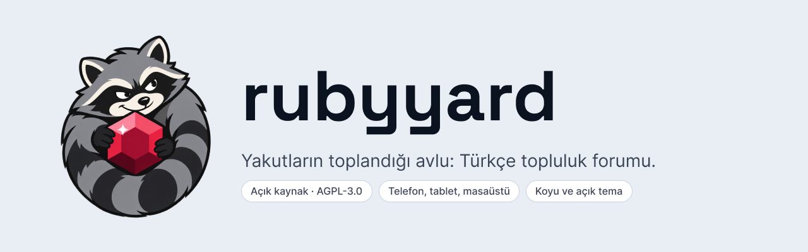
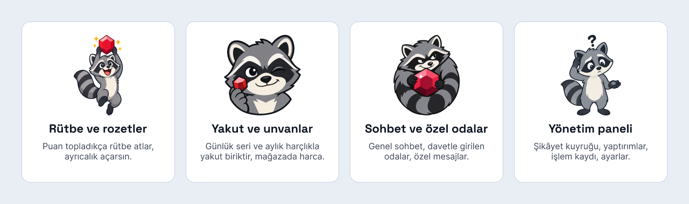
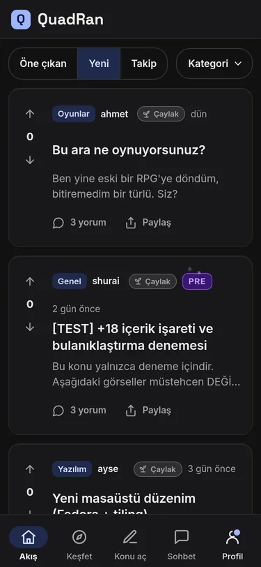
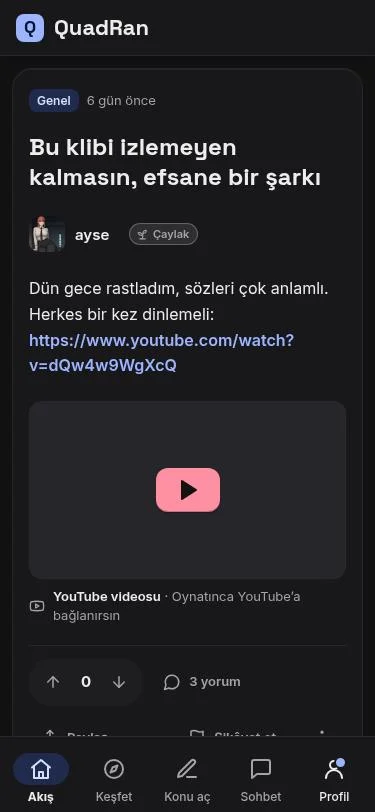
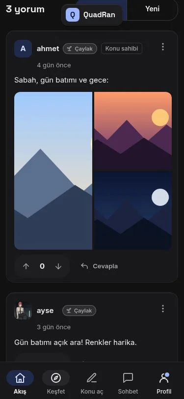
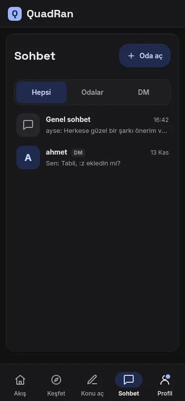
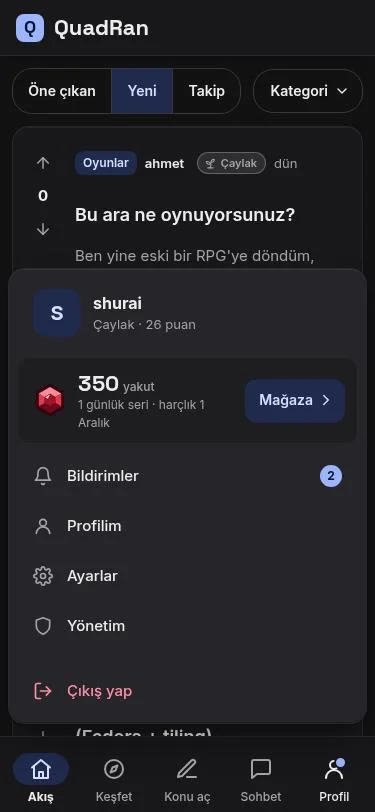
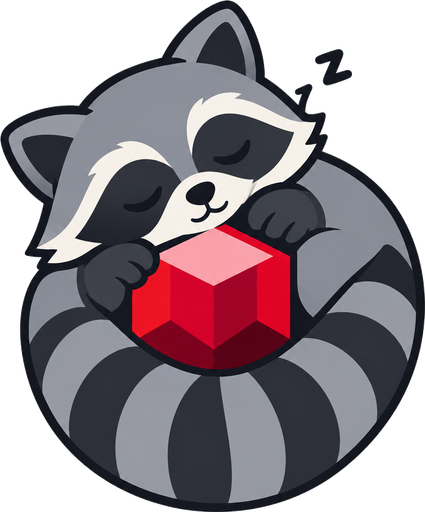

<picture>
  <source media="(prefers-color-scheme: dark)" srcset="docs/marka/github/baslik-koyu.png">
  
</picture>

<p align="center"><a href="README.md">English</a> · <b>Türkçe</b></p>

<p align="center">
  <b>Sürüm 0.7.0</b> ·
  Node.js 22 · Express 5 · EJS · MySQL 8.4 · Docker Compose ·
  <a href="LICENSE">AGPL-3.0</a>
</p>

Üyeler kategorilere ayrılmış konular açar, cevap yazar, oy verir; puan topladıkça rütbe atlar, yakut biriktirir, unvan alır.
Genel sohbet, davetle girilen özel odalar, özel mesajlar, bildirimler ve moderatörler için gelişmiş bir yönetim paneli vardır.

Sitenin arayüzü şimdilik Türkçe; İngilizce arayüz desteği planlanıyor. Kod yorumları İngilizce ve Türkçe yazılır.

<picture>
  <source media="(prefers-color-scheme: dark)" srcset="docs/marka/github/ozellikler-koyu.png">
  
</picture>

## Ekranlar

Telefon, tablet ve masaüstü ayrı ayrı tasarlandı. Aşağıdakiler telefon görünümü; içerik `npm run ornek` ile eklenen örnek veri.

| Akış | YouTube kartı | Fotoğraf ekleri | Sohbet | Profil: yakut ve bildirimler |
|---|---|---|---|---|
|  |  |  |  |  |

## Özellikler

**Site**
- Akış: Öne çıkan / Yeni / Takip, kategori süzgeci, sabitlenmiş konular en üstte
- Konu sayfası: cevap, oy (+1 / −1), kendi mesajını düzenleme ve silme, kilitli konular
- Yorum ekleri: fotoğraf, video (özel oynatıcı), YouTube ve GitHub kartları, +18 işareti; dış bağlantılarda "siteden ayrılıyorsun" onayı
- Profil: avatar ve banner, profil efektleri ve avatar süsleri, rütbe ilerlemesi, rozetler, takip / takipçi
- Rütbe sistemi: rütbeler yeni ayrıcalıklar açar (ör. özel oda açma), rütbe atlayınca kutlama
- **Yakut** para birimi: günlük giriş serisi, rütbeye göre aylık harçlık, mağaza ve unvanlar
- Genel sohbet ve özel odalar (davetle ya da süreli bağlantıyla), özel mesajlar ("görüldü" bilgisiyle), engelleme, bildirimler
- Arama, sıralama (hafta / ay / tüm zamanlar), şikâyet (konu, kullanıcı, sohbet mesajı, özel mesaj)
- Görünüm: koyu / açık / sistem teması, 5 vurgu rengi, kompakt kartlar, "Animasyonları azalt"
- Durum sayfaları (404, 403, 429, 500, bakım) ve çevrimdışı sayfası (service worker)

**Hesap ve güvenlik**
- scrypt ile şifre hash'leme, MySQL'de saklanan oturumlar, "beni hatırla"
- Her POST formunda CSRF belirteci, CSP (satır içi betik yok), giriş / kayıt / şifre sıfırlamada hız sınırı
- Şifre değişince diğer cihazlardaki oturumlar kapanır
- Yüklenen fotoğraflardan EXIF bilgisi silinir, videoların dosya imzası denetlenir

**Yönetim paneli (`/yonetim`)**
- Bakış: ilgilenilmesi gerekenler, metrikler, 30 günlük grafikler
- Moderasyon: tek şikâyet kuyruğu (bağlam, yazar geçmişi, sebebi zorunlu karar), yaptırımlar (süreli / kalıcı uzaklaştırma), yasaklı kelime filtresi
- Forum, Sohbet, Üyeler (üye kartı), Puan ve ödüller (puan kuralları, rütbeler, rozetler, yakut, unvanlar)
- Duyurular ve toplu bildirim, kayıtları açma/kapama, bakım modu, işlem kaydı (kim, ne zaman, ne yaptı)
- Yetki: admin her şeye erişir; moderatör Bakış, Moderasyon, Forum, Sohbet ve Üyeler'i kullanır

## Kurulum


Gereksinimler: Docker (Compose ile) ve Node.js 22.18+

```sh
git clone https://github.com/Shuraimr/rubyyard.git
cd rubyyard
cp .env.example .env          # şifreleri ve SESSION_SECRET'ı doldur
docker compose up -d          # MySQL ilk açılışta sql/ klasöründeki dosyaları sırayla çalıştırır
npm install
npm run dev                   # http://localhost:3000
```

`SESSION_SECRET` için uzun, rastgele bir değer üret:

```sh
node -e "console.log(require('crypto').randomBytes(32).toString('hex'))"
```

- Site: http://localhost:3000 · Yönetim paneli: http://localhost:3000/yonetim
- Adminer (veritabanı arayüzü): http://localhost:8080
- `npm start`: yayın modu (tasarım önizleme sayfaları `/onizleme` kapalı)
- `npm run ornek`: örnek konular, yorumlar, fotoğraf ve video ekleri (`npm run ornek -- --sil` yalnızca onları siler)

**Test kullanıcıları** (seed verisi, şifreleri `test1234`): `shurai` (admin), `ayse` (moderatör), `ahmet` (üye).
Siteyi başkalarının erişebileceği bir yerde açarsan bu şifreleri değiştir.

### Nix ile (isteğe bağlı)

`flake.nix` projeye özel bir geliştirme kabuğu tanımlar: Node 22, MySQL istemcisi, ffmpeg, gh, jq. Sistemdeki araçlara dokunmaz; veritabanı yine Docker'da çalışır.

```sh
nix develop                   # fish için: nix develop -c fish
nix develop -c npm run dev    # kabuğa girmeden tek komut
```

Hepsi bir arada: `./araclar/konsol.sh` veritabanını başlatır ve [zellij](https://zellij.dev) içinde sunucuyu (`npm run dev`), [mycli](https://www.mycli.net) veritabanı istemcisini, MySQL günlüğünü ve bir kabuğu yan yana açar; "Denetim" sekmesinde tip kontrolü ve Docker durumu var (düzen: `araclar/zellij/rubyyard.kdl`). Oturum zaten açıksa ona bağlanır.

[direnv](https://direnv.net) kuruluysa `direnv allow` bir kez çalıştırılır; sonra klasöre girince kabuk kendiliğinden açılır (`.envrc`).

### Var olan bir veritabanını güncellemek

Docker `sql/` dosyalarını yalnızca veritabanı ilk oluşturulurken çalıştırır. Önceden kurulmuş bir veritabanına yeni dosyaları sırayla elle uygula:

```sh
for f in sql/22_*.sql sql/23_*.sql sql/24_*.sql; do
  docker exec -i rubyyard-db sh -c 'mysql -uroot -p"$MYSQL_ROOT_PASSWORD" rubyyard' < "$f"
done
```

(Yalnızca henüz uygulanmamış dosyaları çalıştır; aynı dosyayı iki kez uygulamak "sütun zaten var" hatası verir.)

## Proje yapısı

```
src/
  server.ts           ara katmanlar ve route'ların bağlandığı yer
  db.ts               mysql2 bağlantı havuzu
  oturum.ts           oturum, CSRF, her sayfada gereken ortak veriler
  yardimci.ts         rütbe/puan SQL parçaları, bildirim, giriş zorunlu ara katmanı
  rutbe.ts, yakut.ts  rütbe ayrıcalıkları; yakut bakiyesi ve ödülleri
  ekler.ts            yorum ekleri (fotoğraf, video, kartlar)
  rotalar/            hesap, forum, mesaj, takip, iletisim, odalar, yakut, moderasyon, yonetim-*
views/                EJS şablonları (partials/ ortak parçalar, yonetim/ panel)
public/css, public/js düz CSS ve bağımlılıksız tek bir betik
sql/                  şema, seed ve sırayla uygulanan değişiklikler (01 → 24)
docs/AKTARIM.md       ayrıntılı geliştirici notları: route'lar, tablolar, yetki matrisi, bilinen eksikler
docs/marka/           marka kılavuzu: logo, rakun maskot, renkler (ayrı lisanslı)
```

## Veritabanı

| Tablo | Açıklama |
|---|---|
| `users`, `roles`, `ranks` | Kullanıcılar, roller (admin, moderatör, üye), puana göre rütbeler |
| `categories`, `topics`, `posts`, `post_votes` | Forum: kategoriler, konular, mesajlar ve oylar |
| `badges`, `user_badges` | Rozetler ve kimin hangisini kazandığı (N:N) |
| `points_log`, `yakut_log` | Puan ve yakut hareketlerinin defterleri |
| `chat_messages`, `messages` | Genel sohbet ve özel mesajlar |
| `notifications` | Bildirimler |
| `reports` | Şikâyetler (hedef türüyle: konu mesajı, kullanıcı, sohbet mesajı, özel mesaj, oda mesajı) |
| `audit_log`, `site_settings` | Yetkili işlem kaydı ve panelden değişen ayarlar |
| `password_resets`, `sessions` | Şifre sıfırlama belirteçleri ve oturumlar |

- Rütbe saklanmaz, puandan hesaplanır. Kullanıcı, konu ve mesajlarda soft delete (`deleted_at`) kullanılır.
- Kullanıcıdan gelen her değer sorguya `?` yer tutucusuyla verilir.

## Tasarım


Arayüz Figma'da tasarlandı: bilgi mimarisi, tasarım sistemi (renk değişkenleri, bileşenler, hareket kuralları) ve ekranlar.
Telefon (≤800px), tablet (801–1180px) ve masaüstü (>1180px) ayrı ayrı düşünüldü; koyu, açık ve sistem teması ile
"Animasyonları azalt" her ekranda çalışır. Marka kılavuzu: [`docs/marka`](docs/marka). İlk sürümün (v0.1) ekran çizimleri
arşiv olarak [`docs/tasarim`](docs/tasarim) klasöründe duruyor.

## Durum ve sıradakiler

Forum, rütbe, özel odalar, profil görünümü, takip, yakut ve mağaza, yorum ekleri çalışıyor. Bilinen eksikler (gerçek e-posta
gönderimi, canlı olmayan sohbet) [`docs/AKTARIM.md`](docs/AKTARIM.md) içinde. Sıradaki büyük işler: yardım teklifi, süper yorum
ve bahşiş, referanslı odalar, çok oyunculu oyunlar.

## Lisans



**Kod:** [GNU Affero Genel Kamu Lisansı v3.0 (AGPL-3.0)](LICENSE) ya da daha yeni bir sürümü. Kodu kullanabilir,
değiştirebilir ve ücretli bir hizmet olarak bile sunabilirsin; ama değiştirdiğin hâlini başkalarına (internet üzerinden bir site
olarak sunmak dahil) açtığında kaynak kodunu da aynı lisansla açmak zorundasın. Bağlayıcı olan metin [LICENSE](LICENSE) dosyasıdır.

**Marka:** "rubyyard" adı, rakun maskot, logo ve [`docs/marka`](docs/marka) ile [`public/img/marka`](public/img/marka) klasörlerindeki görseller AGPL kapsamında **değildir**;
tüm hakları saklıdır. Kullanmak için yazılı izin gerekir; kodu çatallarsan adı ve maskotu kaldır. Ayrıntı:
[docs/marka/LICENSE.md](docs/marka/LICENSE.md).
