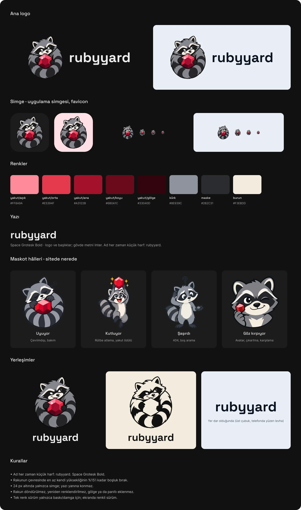
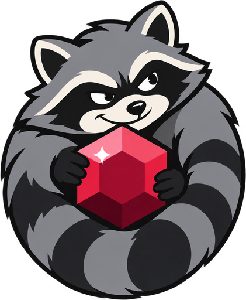
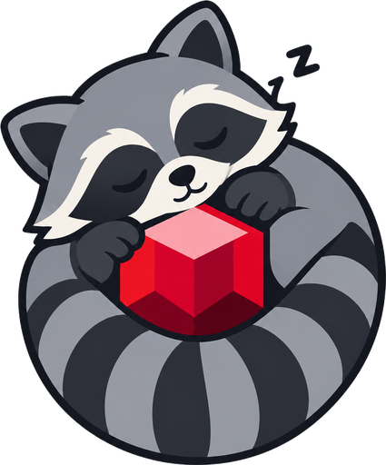
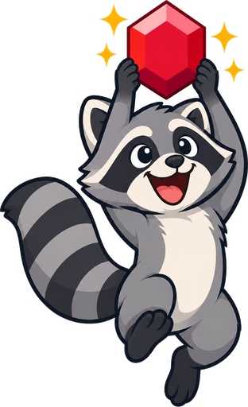
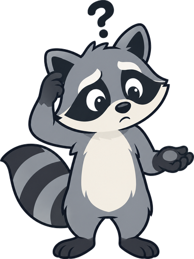
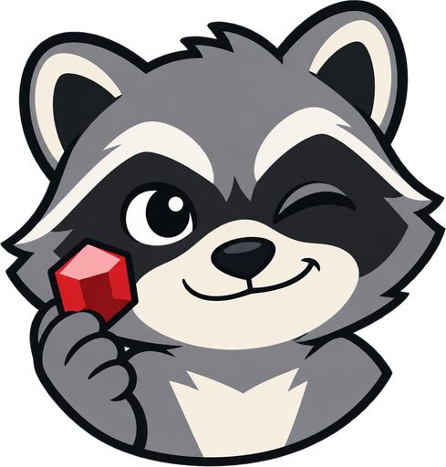
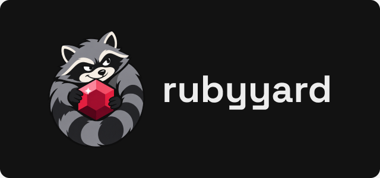
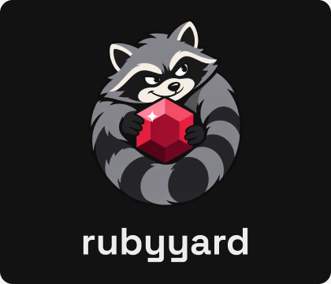
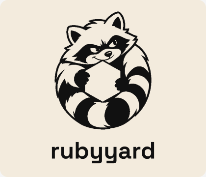
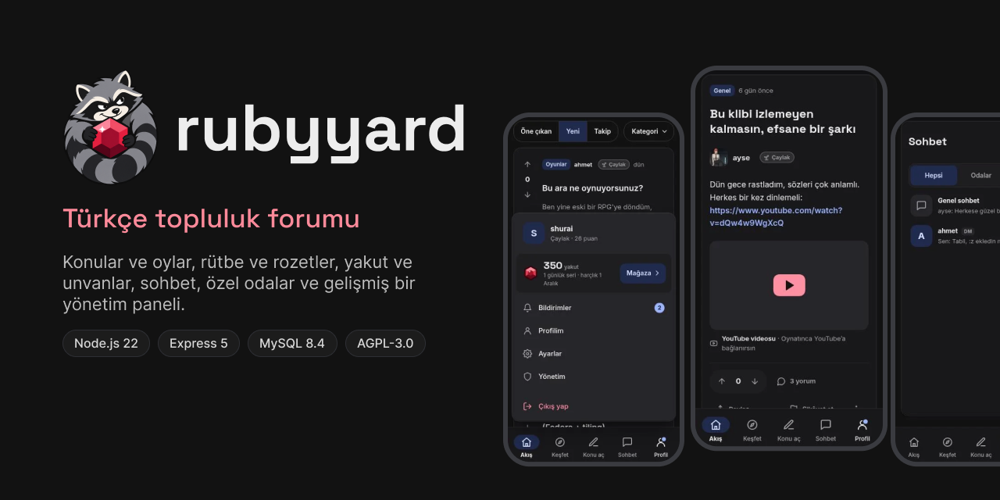

# rubyyard · marka kılavuzu

> Durum: **taslak** (2026-11-21). Site hâlâ QuadRan adını taşıyor; ad değişikliği ayrı bir karar.
> Tasarım kaynağı: Figma › "16 · Rubyyard logo" sayfası. Bu klasör, o tasarımın repodaki kopyası.



## Ad

**rubyyard** = *ruby* (yakut) + *yard* (avlu). Yakutların toplandığı avlu: sitenin para birimi olan yakut ile topluluğun buluştuğu yer.
Her zaman küçük harfle yazılır: `rubyyard`. Cümle başında bile değişmez.

## Maskot: rakun

Rakun parlak şeyleri toplar; bu yüzden yakut biriktiren bir topluluğun maskotu o. Logoda rakun halkalı kuyruğuyla bir daire çizer ve
altıgen yakutu (sitedeki yakut parasının B3 kesimiyle aynı) sarar.

| Hâl | Görsel | Sitede nerede |
|---|---|---|
| Logo (sarmal) |  | Üst çubuk, favicon, uygulama simgesi |
| Uyuyor |  | Çevrimdışı, bakım modu |
| Kutluyor |  | Rütbe atlama, yakut ödülü penceresi |
| Şaşırdı |  | 404, boş arama sonucu |
| Göz kırpıyor |  | Varsayılan avatar, çıkartma, karşılama |

## Logo yerleşimleri

| Yatay (ana) | Üst üste | Tek renk (baskı) |
|---|---|---|
|  |  |  |

- **Yatay:** varsayılan; masaüstü üst çubuk, sosyal medya kapağı.
- **Üst üste:** kare alanlar (karşılama ekranı, sunum kapağı).
- **Yalnız yazı:** yer dar olduğunda (telefondaki yüzen logo levhası). 24 px altında yazı kullanılmaz, yalnızca simge.
- **Tek renk:** yalnızca baskı/damga için; ekranda her zaman renkli sürüm.

## Simge

| Dosya | Kullanım |
|---|---|
| [`logo/uygulama-simgesi-512.png`](logo/uygulama-simgesi-512.png), [`-192`](logo/uygulama-simgesi-192.png) | PWA / ana ekran simgesi (koyu yüzey `#1C1C1C`, köşe 112/512) |
| [`logo/favicon-32.png`](logo/favicon-32.png) | Tarayıcı sekmesi |
| [`logo/isaret.png`](logo/isaret.png) | Şeffaf zeminli ana işaret (512 px) |
| [`logo/isaret-yastik.png`](logo/isaret-yastik.png) | Yedek: yastık kesimli yakutla aynı rakun |

## Renkler

Yakut tonları sitenin yakut parasıyla aynıdır (`docs/tasarim-kaynak/yakut/yakut-b3.svg`).

| Ad | Hex | Kullanım |
|---|---|---|
| yakut/açık | `#FF8A9A` | Yakutun ışık alan yüzü |
| yakut/orta | `#E5394F` | Yan yüzler |
| yakut/ana | `#A3122B` | Ana yakut rengi |
| yakut/koyu | `#6B0A1C` | Gölgede kalan yüzler |
| yakut/gölge | `#33040D` | En koyu ton |
| kürk | `#8E939C` | Rakunun kürkü |
| maske | `#2B2C31` | Göz maskesi, kuyruk halkaları |
| burun | `#F3EBDD` | Burun ve kaşlar; tek renk baskının kâğıdı |

Arayüz renkleri değişmez: site kendi token'larını (`--zemin`, `--yuzey-*`, `--vurgu`…) kullanmaya devam eder. Yakut rengi
vurgu seçeneklerinden biri (`data-vurgu="yakut"`).

## Yazı

- Logo ve başlıklar: **Space Grotesk Bold** (sitede zaten kullanılıyor).
- Gövde metni: Inter.

## Kurallar

- Rakunun çevresinde en az kendi yüksekliğinin %15'i kadar boşluk bırak.
- Rakun döndürülmez, yeniden renklendirilmez; gölge, parıltı ya da gradyan eklenmez.
- Rakunu başka bir hayvanla ya da başka bir taşla değiştirme. Yakut her zaman altıgen (B3) kesimdedir.
- Maskot hâlleri yalnızca tablodaki yerlerde kullanılır; aynı ekranda iki rakun olmaz.

## GitHub tanıtımı

Figma › "17 · GitHub tanıtımı (rubyyard)". Ekran görüntüleri `docs/ekranlar/`'dan alınıp üst çubukları kırpıldı (eski QuadRan logosu görünmesin diye).

| Dosya | Nerede |
|---|---|
| [`github/paylasim-1280x640.png`](github/paylasim-1280x640.png) | Depo › Settings › Social preview (bağlantı paylaşılınca görünen kart) |
| [`github/baslik-koyu.png`](github/baslik-koyu.png) / [`-acik`](github/baslik-acik.png) | README'nin en üstü (GitHub temasına göre `<picture>` ile seçilir) |
| [`github/ozellikler-koyu.png`](github/ozellikler-koyu.png) / [`-acik`](github/ozellikler-acik.png) | README'de "Özellikler" başlığının altı |

README'de kullanım:

```html
<picture>
  <source media="(prefers-color-scheme: dark)" srcset="docs/marka/github/baslik-koyu.png">
  
</picture>
```



## Lisans

Marka varlıkları (ad, rakun maskot, logo, bu klasördeki görseller) **AGPL kapsamında değildir; tüm hakları saklıdır.**
Kullanmak için sahibinden yazılı izin gerekir. Ayrıntı: [LISANS.md](LISANS.md).

## Sıradakiler

- [ ] Rakunu katmanlı vektöre çevirmek (baş, kuyruk, yakut ayrı): animasyonun ön şartı.
- [ ] Animasyon: kuyruk dalgalanması, göz kırpma, yakut ışıltısı. "Animasyonları azalt" açıkken durağan.
- [ ] Ad değişikliği kararı (QuadRan → rubyyard) ve alan adı alımı.

## Kaynak dosyalar

- Ham görseller: [`docs/tasarim-kaynak/logo/`](../tasarim-kaynak/logo/) (Figma'nın görsel üretme aracıyla üretildi, zemin
  `sharp` ile kaldırıldı).
- Bu klasördeki görseller 512 px'e küçültülmüş kopyalardır.
